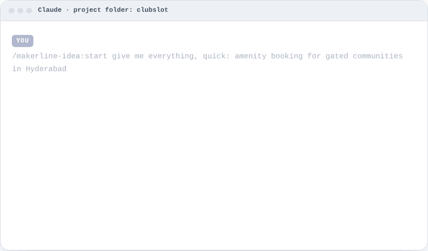

<p></p>

# MakerLine v0.13

**Know if it's worth building. Then build it right.**

MakerLine is a free, open-source Claude plugin for designers and solo makers who build with AI. Describe an idea in a few sentences and it interviews you, researches real competitors, and gives an honest evaluation: a verdict, the strongest version of the idea, who it leaves out and how to make it stronger. It sketches a design direction with clickable wireframes and a draft PRD. Nothing is built until you approve. Then it sets up your brand, stack, design system and engineering docs, and builds one task at a time, with accessibility, security and tests checked by hooks and CI. Accessible worldwide is the baseline: every product meets WCAG 2.2 AA and the accessibility law of the markets it launches in. The same rules work in **Claude**, **Cursor**, **Codex** and 12 more AI tools.

<p></p>

> **One command:** `/makerline:start` + your idea + "give me everything". **Website: https://sairam5294.github.io/makerline/** · **New here? Read [GETTING-STARTED.md](GETTING-STARTED.md)** — how to run it and how to update it, step by step.

**Why it exists.** AI tools write working code fast, but they forget accessibility, UX heuristics, security, tests and honest evaluation unless you remind them every session, in every tool. MakerLine packages that know-how as skills, agents, standards, hooks and CI so every tool you use starts thinking like a senior product designer.

**Already building or live?** Run `/makerline:product-opportunity-review` to decide whether to finish, narrow, launch, pivot or improve next. It creates a stage-aware, accessible HTML report with evidence, saved step progress, options and an action plan. See [which workflow and example prompts](docs/PRODUCT-WORKFLOWS.md) and [installation across AI tools](docs/INSTALL-AI-TOOLS.md).

**What you get**
- A 13-phase workflow from discovery interview to post-launch retro, with an approval gate AI tools cannot bypass
- An **Idea Pack** for every idea before any code: honest, constructive evaluation, competitors and a differentiator test, a strengthening plan, draft design direction with clickable wireframes, a draft PRD and a one-pager, with an accessibility, inclusion and compliance lens (who it excludes, AODA / ADA / EAA / RPwD obligations by launch market). Three depths — Quick (~120k tokens measured), Standard, Deep — and `check_idea_pack.py` to verify the pack before you see it
- 26 skills and 14 specialist agents (strategist, UX reviewer, accessibility auditor and accessibility strategist, security reviewer, QA, devil's advocate and idea champion…)
- Standards for accessibility (WCAG 2.2 AA), UX, security, testing, backend and AI features — split into small files so only the relevant ones load
- Two tested starters: Expo + Supabase (iOS / Android / web) and Next.js (landing page + waitlist), both with axe, Lighthouse and contrast tests
- Safety hooks, git hooks and GitHub Actions that block dangerous commands, leaked secrets and code before approval
- One design-token source for Figma and code, plus evals that check the skills still catch planted flaws

Licensed under [MIT](LICENSE). Contributions welcome — see [CONTRIBUTING.md](CONTRIBUTING.md).

## What's inside

```
makerline/
├── plugin/        THE SOURCE — edit only here (25 skills, 14 agents, standards). Installs into Claude.
├── template/      Copied into every project: AGENTS.md, safety settings, CI, git hooks, MCP, Cursor/Codex adapters
├── starter/       Tested Expo (iOS/Android/Web) + Supabase app: i18n (en/te/hi), Sentry, PostHog
├── starter-web/   Tested Next.js site: landing page + waitlist (nonce CSP, rate limit, optional Turnstile), AI harness with evals; Lighthouse 1.0/1.0/1.0
├── design/        tokens.json (single source for Figma + code) + build-tokens.mjs · Figma library: https://www.figma.com/community/file/1692097443572763844/makerline-design-system
├── owner/         OWNER.example.md → copy to OWNER.md (git-ignored): your profile, copied into every project
├── portfolio/     OUTCOMES.md (idea outcomes) + generated dashboard (index.html)
├── evals/         Sample cases with planted flaws + RUNBOOK (runs monthly on your Mac)
├── scripts/       new-project · upgrade-project · release-kit · build-plugin · portfolio · setup-github · sync · install-global
├── .github/       Kit CI: keeps template in sync, tests both starters
├── CHANGELOG.md   What changed per version
└── LESSONS.md     What the kit got wrong, fed back after each project
```

## Workflow

| # | Skill | Output (`docs/product/`) |
|---|---|---|
| 0 | **product-kickoff**: say "I have a new idea" | runs everything below, tracks `STATUS.md` |
| 1 | new-idea: discovery interview; every unknown logged with what it blocks | PROJECT_BRIEF.md · CLARITY.md |
| 2 | evaluate-idea: researched and constructive — strongest version, reality check, competitors and differentiator test, strengthening plan with a path to Go, tools and cost | EVALUATION.md · COMPETITORS.md |
| 2a | design-direction: principles, flows, screen inventory, 2–3 visual directions, clickable low-fi wireframes (optionally in Figma) | DESIGN_DIRECTION.md · design/wireframes/ |
| 2b | write-prd (draft): problem, metrics, personas, scope, stories, risks, release plan | PRD.md v0 |
| 3 | validate-idea: kill criteria, interviews, landing page, prototype test with the wireframes | VALIDATION.md |
| ✦ | **Idea Pack**: one-pager + index of everything above — say "give me everything for this idea" to run 1 → 2b in one go | ONE_PAGER.md · README.md |
| ★ | **Approval gate**: no app code before `Evaluation: APPROVED` (enforced) | STATUS.md |
| 4–8 | name-product (+ **brand**: logo, guidelines, colours, fonts, icons) · tech-stack · design-system · write-prd · **engineering-docs** (architecture, database, security, code style, testing, rules, memory, lifecycle) · **project-setup** (README, setup, folder structure, commented `.env.example`, GitHub rules, `.claude` / `.cursor` / `.github` rules) · plan-build | NAMING · BRAND · TECH_STACK · DESIGN_SYSTEM · PRD · `docs/*.md` · PLAN |
| 9 | build-feature (+ design-qa against Figma) | code + tests |
| 10–12 | quality-review · test-plan · ship-checklist (incl. expert review) | reviews/ · TEST_PLAN · RELEASE |
| 13 | post-launch: weekly metrics, feedback, retros → LESSONS | METRICS · LESSONS |
| any | **tool-plan** (which AI subscription does which job) · handoff (end of every session) · portfolio (all projects) · ai-feature (any AI feature) · standards-refresh (quarterly) | HANDOFF.md · AI_FEATURE_*.md |
| any | **product-opportunity-review**: stage-aware decision for half-built, delayed, prelaunch or live products; can also show a fresh idea in the HTML view | opportunity/REVIEW.json · opportunity/index.html |

## What enforces the rules

| Layer | Catches | Works for |
|---|---|---|
| Claude Code hooks + permissions | code before approval, AI self-approval, `rm -rf`, force-push, push to main, reading `.env` secrets, destructive DB commands; auto-formats edits | Claude Code |
| `permissions.json` + `.cursorignore` | secrets and risky commands | Cursor |
| `.codex/config.toml` | sandboxed writes, no network without asking | Codex |
| lefthook git hooks | approval gate, leaked secrets, lint, format; no direct push to main; full check before push | every tool |
| AI review on every PR (`ai-review.yml`) | kit quality-review posted as a PR comment (needs one Claude secret) | every tool |
| GitHub Actions CI (actions pinned to SHAs) | gate, secret scan, typecheck, lint, tests, dependency audit, axe on Chrome + Safari engines, Lighthouse, RLS database tests | every tool |
| Starter tests | colour contrast (light + dark), token drift, accessible components, translations, sign-in validation, session storage, privacy scrubbing | every tool |
| Kit tests (`tests/hooks.test.sh`, actionlint) | the safety hooks block/allow exactly what they promise; workflow files are valid | the kit itself |

## Setup (once)

```bash
git clone https://github.com/sairam5294/makerline ~/Documents/makerline
cd ~/Documents/makerline
brew install gh gitleaks                                   # GitHub CLI + secret scanning; Node 22+ required
claude plugin marketplace add sairam5294/makerline       # Claude Code
claude plugin install makerline@makerline
./scripts/build-plugin.sh                                  # Claude app instead: open ../makerline.plugin → Install
cp owner/OWNER.example.md owner/OWNER.md                   # your profile (git-ignored); fill in hours, budget, accounts
```
Full walkthrough, including Cursor and Codex: [GETTING-STARTED.md](GETTING-STARTED.md).

**Only want the idea stage?** Install the standalone **Idea Pack** plugin instead (discovery → evaluation → design direction → draft PRD → one-pager, no build phases): `claude plugin install makerline-idea@makerline`, or open `makerline-idea.plugin` in the Claude app (built by `python3 scripts/build-idea-pack.py --zip ..`). See [makerline-idea/README.md](makerline-idea/README.md).

Where the rules are enforced: Claude Code, Cursor and Codex get hooks, git hooks and CI. **Claude Cowork/desktop has no hooks**, so there the skills follow the gate rules themselves. Use Cowork for phases 1–8 (docs) and Claude Code, Cursor or Codex for building.
Scheduled in Claude: a quarterly standards check (1 Jan, 1 Apr, 1 Jul, 1 Oct) and monthly evals on your Mac (3rd of each month).

## Start a project

```bash
./scripts/new-project.sh ~/Projects/my-app             # any stack: rules, skills, agents, safety, CI
./scripts/new-project.sh ~/Projects/my-app --starter   # + tested Expo + Supabase app (iOS/Android/web)
./scripts/new-project.sh ~/Projects/my-site --web      # + tested Next.js site (landing page, SEO, waitlist)
cd ~/Projects/my-app && scripts/setup-github.sh        # private GitHub repo + push + protect main (needs: brew install gh)
npx lefthook install                                   # git hooks (after setup-github)
```

Then say **"I have a new idea"** in Claude, Cursor or Codex. After the evaluation, **you** approve with `scripts/approve.sh`. AI tools can't approve for you.

Keep projects current when the kit improves: `./scripts/upgrade-project.sh ~/Projects/my-app` (preview) → add `--apply`. The same command adopts a project built before the kit, in any stack, without overwriting anything it already has.
See everything at once: `python3 scripts/portfolio.py` → open `portfolio/index.html`.

GitHub Free can't protect `main` on private repos. setup-github.sh tells you if so, and the `no-push-to-main` git hook covers it locally. The kit repo itself uses the same idea: run `git config core.hooksPath .githooks` once per clone, and pushes to `main` are refused — work on `<type>/<Mon>-<DD>-<summary>` branches (`scripts/branch.sh fix "what changed"`) and merge through pull requests.

## The cockpit (optional web UI)
A local page that shows every project, its phase, whether it's approved, and the exact prompt to paste next — the chat still does the work.
```bash
python3 scripts/kit-ui.py --projects ~/Desktop/Code_Projects/"MakerLine"/projects   # then open http://127.0.0.1:8765
```
Runs only on your computer, reads your files, writes nothing unless you tick "save" on the New idea form. Details: [kit-ui/README.md](kit-ui/README.md).

## Works with your AI tools
One rulebook (`AGENTS.md`) for Claude, Cursor, Codex, Copilot, Gemini CLI, Windsurf, Cline, Roo Code, Zed, JetBrains Junie, Kiro, Antigravity, OpenCode, Amp, Aider and Continue — see `template/docs/kit/AGENT-ADAPTERS.md`.

## Using the three tools together

- **Claude**: discovery, evaluation, planning, multi-file features, parallel reviews.
- **Cursor**: visual UI iteration with live preview.
- **Codex**: well-defined independent tasks in parallel (tests, endpoints).
- Give each tool its own task folder: `scripts/worktree.sh new T-07 lesson-player`, which creates `../my-app-T-07`.
- End every session with **handoff**, so the next tool picks up exactly where you stopped.

## Token-saving design

- Always-loaded text (skill + agent descriptions + AGENTS.md) stays around 2,300 tokens for 20 skills and 12 agents. v0.1 used ~3,000 for 13 skills.
- Checklist agents run on a faster model; research is cached in `docs/product/research/`; drafts can use a free local model (`scripts/local-ai.sh`).
- Skills load their detail only when used. Standards are split into 10 files, and only the relevant ones are read.
- Subagents return summaries of 300 words or less. Reviewers get the diff plus one standard file.
- Formatting is done by hooks, not by the AI.
- `.cursorignore` and deny rules keep secrets and generated folders out of context.
- Full rules: `plugin/skills/product-standards/references/context-budget.md`.

## Changing the kit
Edit files in `plugin/`, then `./scripts/release-kit.sh <new-version> "what changed"` (sync + tests + version + CHANGELOG + rebuild plugin + commit). Reinstall the plugin in Claude, then `./scripts/upgrade-project.sh <project>` for projects you want updated. Details: GETTING-STARTED.md → Part 3.

## Contributing
See [CONTRIBUTING.md](CONTRIBUTING.md) for ground rules, [SECURITY.md](SECURITY.md) to report a vulnerability, and [LESSONS.md](LESSONS.md) for what the kit has got wrong so far. Issue templates cover bugs, rule proposals and new skills or adapters.

## Other plugins
You also have design / engineering / product-management plugins. The kit's versions win for kit phases (see `template/docs/kit/PLUGIN-OVERLAP.md`); complementary skills like ux-copy and research-synthesis are used inside phases.

---

Created by **[Sairam Mogullapalli](https://www.sairammogullapalli.com/)**, Head of Product Design, building products with AI ([GitHub](https://github.com/sairam5294)). MIT licence.
