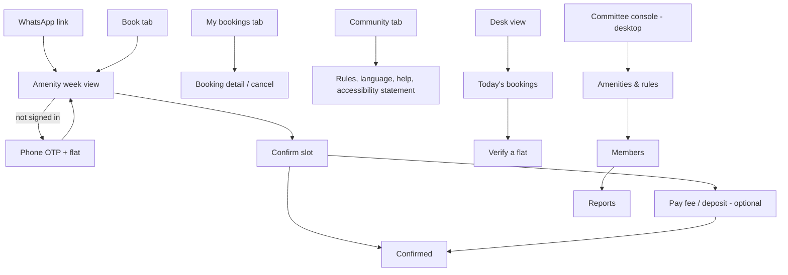
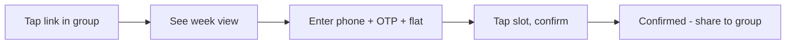
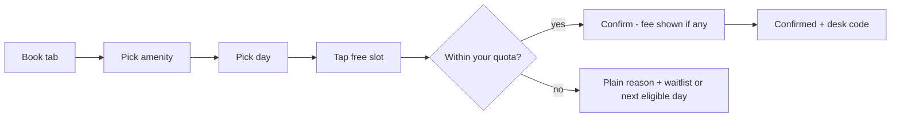
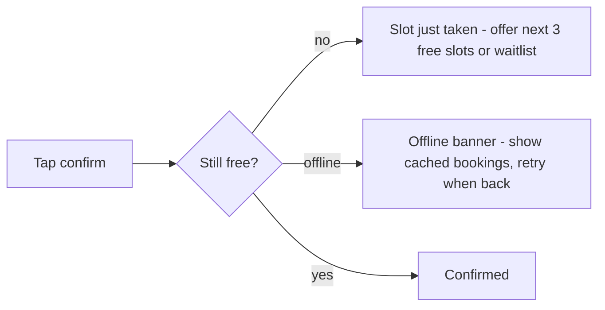

# Design Direction — ClubSlot

_Draft v1 · 2026-10-19 · Based on PROJECT_BRIEF v1, EVALUATION v1 · Wireframes: `design/wireframes/index.html` · **Pivot: booking-only wedge (EVALUATION §8, pivot A).** If the owner keeps the brief as written, add visitor-pass, complaints and notices tabs to the IA and the screen count roughly doubles; the principles and visual direction stand._

Assumptions taken because the owner was unavailable (all logged in CLARITY.md): **[Default]** phone-first installable web app for residents and the desk, desktop width for the committee set-up (Q-02); **[Default]** English + Telugu strings (Q-11); **[Default]** the pilot is the owner's own community (Q-04).

## 1. Summary
ClubSlot is for residents who want a court or hall without a fight, committee members who want the fights to stop, and the guard at the desk who has to settle them. It should feel like a calm notice board, not a super-app: one amenity at a time, the rule stated in plain words, and a confirmation the desk can read from across the counter. The recommended visual direction is **A — "Notice board"**: warm paper tones, one deep green accent, large type. A new resident reaches a confirmed booking in **4 steps** from the WhatsApp link (leaders: estimated 6–8 including install and registration — Estimate, not measured; Q-06).

## 2. Experience principles
| Principle | This means… | This doesn't mean… |
|---|---|---|
| Fair, and seen to be fair | Every rule is stated next to the slot it affects ("2 court hours per flat per week — you've used 1"); the waitlist order is visible | Lecturing; hiding rules in a settings page |
| One tap from WhatsApp | The link in the group opens the right amenity, signed in or with a 10-second OTP; no install, no onboarding tour | Never offering a home-screen install prompt |
| Quiet | Notifications only about your bookings; no ads, no feed, no promotions | No communication at all — confirmations are loud and clear |
| Desk-proof | Any booking can be verified on a guard's low-end phone in Telugu at 200% text in under 5 seconds | A separate guard app |
| Calm under conflict | Errors say what happened and what to do; a cancellation is reversible for 10 minutes; the desk can override with a logged reason | Letting anyone silently override |

## 3. Competitor UX teardown
| Leader | Steps to core action | Borrow | Avoid (from review complaints) | Source |
|---|---|---|---|---|
| MyGate | Install → register with phone → society approval → Community tab → Amenities → slot → pay (≈ 7, Estimate; the approval step can take hours) | Guard-side verification is a first-class flow; dues and bookings in one wallet | "endless, inescapable ads", notification flood, features "held back" for paying users (R9) | R2, R9 |
| NoBrokerHood | Install → register → society approval → facility booking (≈ 6, Estimate) | Free entry for committees; polls for rule changes | Unknown (Q-06) | R3 |
| ADDA | Committee-first; resident books via Gatekeeper/app after set-up (≈ 6, Estimate) | Zero-fee UPI framing; committee audit trail | "slightly complex for first-time users" (ApnaComplex, same class, R5) | R4, R5 |
| WhatsApp + register | Message the group → wait → maybe confirmed → tell the guard (2 steps, but no confirmation) | Reach; the share link lives here | No visibility, no fairness, double bookings (R13) | R13 |

## 4. Information architecture
- Navigation model: **three tabs for residents** (Book · My bookings · Community) — because residents have two jobs (find a slot, check my slots) and one occasional one (rules, help, language); **single flow for the desk** (today's list, search a flat); **sidebar for the committee console** on desktop (Amenities · Rules · Members · Reports · Settings).

## 5. Core flows
### 5.1 First run → first value

Steps to the core action: **4** (link → OTP → slot → confirm); returning user **3** (leaders: ≈ 6–7 including install and society approval — Estimate).
### 5.2 The core action

### 5.3 Recovery path (slot taken while confirming · offline)

## 6. Screen inventory
| # | Screen | Purpose | Primary action | Key content | States | MVP? |
|---|---|---|---|---|---|---|
| S-01 | Link landing / week view (signed out) | Show the amenity is free before asking for anything | Tap a slot | Amenity name, week strip, slots with state, the rule in one line | loading · empty (no amenities set up) · error · offline · success | MVP |
| S-02 | Sign in: phone OTP + flat | Identify the flat for fairness rules | Send code → verify | Phone, OTP, flat picker, privacy line | error (wrong code, unknown flat) · loading | MVP |
| S-03 | Book tab: amenity list | Choose what to book | Open amenity | Amenities with "next free" and your remaining quota | empty · loading · error · offline | MVP |
| S-04 | Confirm slot | Make the rule visible, take the fee if any | Confirm booking | Slot, rule status, fee/deposit, cancellation terms | error (slot taken, quota used) · loading · success | MVP |
| S-05 | Confirmed | The aha: proof the desk can read | Share to group / Done | Desk code, time, amenity, add-to-calendar | success | MVP |
| S-06 | My bookings | See and cancel | Cancel (10-min undo) | Upcoming, past, waitlist position | empty · loading · error · offline | MVP |
| S-07 | My bookings — empty | First-time nudge | Book something | Empty copy | empty | MVP |
| S-08 | Desk view (today) | Guard verifies in 5 s | Search flat | Today's list, large text, Telugu toggle | empty · loading · error · offline | MVP |
| S-09 | Committee console: amenities & rules (desktop) | One-evening set-up | Save rules | Amenity hours, quota, advance window, fee, deposit, plain-language preview | empty · error · success | MVP |
| S-10 | Community tab: rules, language, help, accessibility statement | Trust and support | — | Rules list, language, report a barrier, contact | — | MVP |
| S-11 | Reports (utilisation, no-shows) | Renewal reason for the payer | Export | Monthly charts | — | Later |
| S-12 | Waitlist detail | Position and auto-promotion | Leave waitlist | Position, who's ahead (flat count only) | — | Later (v1 shows position on S-06) |

Wireframes cover S-01 to S-08 (8 screens, Standard cap); S-09 and S-10 are described here and in the PRD.

## 7. Content and voice
- Tone: **plain, fair, neighbourly** — do: say the rule and the reason in one sentence; use "your flat", "this week"; don't: scold, use "violation", "denied", or exclamation marks.
- Terminology: amenity → "amenity" (never "facility"); a bookable period → "slot" (never "session"); the community's limits → "rules" (never "policy"); the guard's screen → "desk" (never "gate"); a flat's allowance → "your turns this week" (never "quota" in resident-facing copy).

| Moment | Copy |
|---|---|
| Onboarding promise (S-01) | "See what's free. Book in a tap. Everyone gets a fair turn." |
| Main empty state (S-07) | "No bookings yet. The badminton court has slots free tonight — want one?" |
| Main error (S-04, slot taken) | "Someone booked 7–8 pm just now. The next free slots are 8–9 pm and tomorrow 7–8 pm, or join the waitlist for 7–8 pm." |
| Rule reached (S-04) | "Your flat has used both court hours for this week. Your next turn opens Monday — or join the waitlist, which fills free slots in order." |
| Success moment (S-05) | "Booked. Badminton court, Thu 7–8 pm. Show code 4KQ2 at the desk — or just say flat B-1204." |
| Offline banner | "You're offline. Showing your saved bookings; we'll retry when you're back." |

## 8. Visual directions
### Option A — Notice board (recommended)
- Mood: calm, civic, warm
- Palette:

  | Role | Colour | On | Contrast |
  |---|---|---|---|
  | Text | #1b1b1f | #fbf7ef (paper) | 16.07:1 |
  | Text on card | #1b1b1f | #f3e9d8 | 14.27:1 |
  | Primary action text | #ffffff | #0f5c4a (deep green) | 7.92:1 |
  | Secondary text | #3b3b3b | #fbf7ef | 10.48:1 |
  | Rule / warning text | #7a3e00 | #fbf7ef | 7.81:1 |
  | Error text | #ffffff | #9a1f1f | 8.11:1 |
  | Free slot label | #0f5c4a | #e8f1ee | 6.89:1 |

- Type: a humanist sans with Telugu support (Noto Sans + Noto Sans Telugu) for both display and text; base size 17 px, desk view 22 px
- Shape and spacing: 12 px radius, generous 16/24 px spacing, slots as tall buttons (≥ 48 px)
- Imagery and icons: no illustrations in the core flow; simple outlined icons always paired with text; one amenity photo per community (committee-supplied, with alt text)
- Motion: none beyond focus and a 200 ms confirm; respects reduced motion
- Reference product (for feel, not to copy): a well-run library's booking kiosk; Google Calendar's clarity without its density
### Option B — Scoreboard
- Mood: energetic, sporty, crisp
- Palette: text #1b1b1f on #ffffff (17.17:1); primary #ffffff on #2b3a8f (9.98:1); accent chips #ffffff on #b42318 (6.57:1)
- Type: condensed display for amenity names, standard sans for body; base 16 px
- Shape: 8 px radius, denser grid, bold slot blocks
- Reference: sports-booking apps; fits courts, less so party halls and older residents
### Option C — Utility (optional)
- Mood: neutral, system-like, invisible
- Palette: text #1b1b1f on #f2f4f7 (15.58:1); primary #ffffff on #0b3d91 (10.04:1); muted #5b6168 on #ffffff (6.26:1)
- Type: platform defaults; base 16 px
- Reference: Material 3 defaults — fastest to build, least distinctive
**Recommendation and why:** **A [Default]** — it reads as the community's own notice board rather than a vendor's app, suits older residents and Telugu text, and separates ClubSlot from the super-apps' dense, ad-heavy feel (R9). B is a strong alternative if the pilot community is court-heavy; C if build speed trumps feel.
Platform conventions to follow: web (PWA) — native-feeling tabs, system fonts fallback, Material 3 touch targets on Android, HIG safe areas on iOS Safari.

## 9. Accessibility and inclusion plan
- Conformance target: **WCAG 2.2 AA** (kit floor) + India GIGW 3.0 / IS 17802 alignment, accessibility statement and barrier-feedback route (EVALUATION §11), DPDP consent notice in plain English and Telugu.

| Need (persona · permanent / temporary / situational) | Design response | Where (S-xx) |
|---|---|---|
| Low vision, reading glasses (P-01 · permanent/temporary) | 17 px base, 200% without horizontal scroll, 4.5:1+, desk view at 22 px | all; S-08 |
| Telugu-first readers (P-03 · situational/literacy) | Language toggle on first screen and desk; all strings translated by a native speaker | S-01, S-08, S-10 |
| Screen-reader users (permanent) | Each slot is a `<button>` named "Thu 7–8 pm, free" / "booked by another flat"; live region announces confirmation | S-01, S-04, S-05 |
| One-handed, walking (P-02 · situational) | Primary actions in the bottom third; no drag; 48 px targets | S-01, S-04 |
| Low-end phone, slow data (P-03 · situational) | < 200 KB first load, cached "my bookings", offline banner | S-06, S-08 |
| No smartphone (situational) | Desk books on behalf of a flat with a logged reason | S-08 |
| Cognitive load under conflict (everyone · situational) | One decision per screen; errors name the next free option; 10-minute undo on cancel | S-04, S-06 |

- Cognitive: plain language (reading age ~12), one task per screen, no time pressure (no checkout countdown), forgiving inputs (phone with country picker, flat number accepts "B1204" or "B-1204")
- Languages and scripts: English + Telugu at launch **[Default]**; Hindi, Kannada for Bengaluru later
- Locked in now (expensive to retrofit): no drag-only interactions, no CAPTCHA (OTP instead), status never colour-only (text + shape), text never in images, slots as real buttons, strings in a translation file, consent and retention in the data model, desk view designed at 200% first
Floor: WCAG 2.2 AA — contrast, 44 pt / 48 dp targets, text to 200 %, screen-reader names, focus order, reduced motion.

## 10. Wireframes
- File: `design/wireframes/index.html` — open in a browser; "Prototype" mode clicks through the core flow.
- Screens covered: S-01 week view (signed out), S-02 sign in (with error), S-03 book tab, S-04 confirm (with slot-taken error and rule reached), S-05 confirmed, S-06 my bookings, S-07 my bookings empty, S-08 desk view (desktop-width section, Telugu) · states shown: empty, error, offline banner, success
- What a 5-person prototype test should check (→ validate-idea): can a resident book a slot from the link in under 2 minutes unaided; do they understand "your turns this week" without explanation; does the guard find flat B-1204 on the desk view in under 5 seconds; does the slot-taken error lead to a second booking rather than abandonment; does a large-text user complete the flow.

## 11. Design decisions for the owner
| Decision | Options | Recommendation |
|---|---|---|
| Visual direction | A Notice board · B Scoreboard · C Utility | **A [Default]** |
| Platform for v1 | PWA + WhatsApp links · native Android + iOS | **PWA [Default]** (Q-02) |
| Sign-in | Phone OTP + flat · committee-issued invite link · both | OTP + flat, with committee approval of unknown flats **[Default]** |
| Resident-facing word for allowance | "your turns this week" · "quota" · "limit" | "your turns this week" **[Default]** |
| Languages at launch | English only · English + Telugu | English + Telugu **[Default]** (Q-11) |

## 12. Open questions (also in CLARITY.md)
- Q-02 platform; Q-11 languages; Q-09 which rules (deposits, owner-only) the pilot's bylaws require; Q-10 whether the pilot already runs a super-app at the gate (affects the desk view's role).
- New: Q-12 Should the desk code be a short code, a QR, or just the flat number? (Default: short code + flat number; QR later.)
