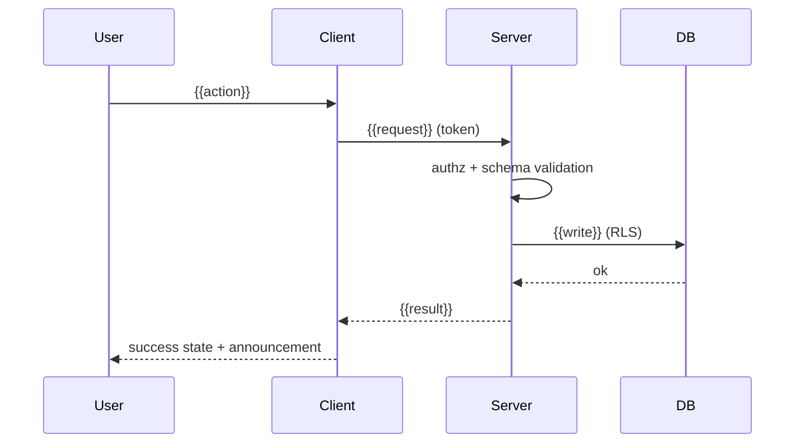

# Architecture — {{product}}

_Updated {{date}} · Stack: `docs/product/TECH_STACK.md` · Decisions: `docs/product/DECISIONS.md`_

## 1. In one paragraph
{{What the system is, who uses it, the one core action, and the 3 biggest shaping constraints (budget, platforms, offline, scale, compliance).}}

## 2. System context
```mermaid
flowchart LR
  U[{{Primary user}}] --> App[{{App / web client}}]
  A[{{Admin / staff}}] --> Admin[{{Admin UI}}]
  App --> API[{{Backend / BaaS}}]
  Admin --> API
  API --> DB[({{Database}})]
  API --> Ext1[{{Payments}}]
  API --> Ext2[{{Email / SMS / push}}]
  API --> AI[{{AI provider — server-side only}}]
```

## 3. Containers and responsibilities
| Container | Technology (version) | Responsibility | Talks to | Hosted on | Cost tier |
|---|---|---|---|---|---|
| {{Mobile app}} | | UI, local state, offline cache | API | stores | |
| {{Web}} | | marketing + web app | API | | |
| {{API / BaaS}} | | auth, authorization, business rules, integrations | DB, external | | |
| {{Database}} | | data, RLS, backups | — | | |
| {{Jobs}} | | scheduled work, webhooks | DB, external | | |

## 4. The core action, end to end
{{Core action from PRD}} — steps with the component that owns each: UI → validation (client) → API (auth → authorization → schema validation → business rule → write) → events/notifications → UI state. Expected latency budget: {{n}} ms.


## 5. Cross-cutting rules
- **Auth & authorization:** {{provider}}; every read/write checked on the server; RLS on every user-data table (`DATABASE.md`).
- **Errors:** fail closed; user-facing errors are plain language with a next step; stack traces never leave the server; all errors to {{error tracking}}.
- **Config & secrets:** environment variables only; `.env.example` committed; server-only keys never in the client bundle.
- **Logging & analytics:** events from PRD §11; no personal data in logs; retention {{n}} days.
- **Offline / low connectivity:** {{what works offline, how sync and conflicts behave}}.
- **Internationalisation:** {{languages, scripts, RTL?}}; all copy in resource files.
- **Accessibility:** tokens and components from `docs/product/DESIGN_SYSTEM.md`; every screen has the five states.
- **AI features (if any):** server-side calls, prompt + model versions pinned, evals in CI, cost cap {{₹/$ per user per month}} (`AI_FEATURE_*.md`).

## 6. Folder layout
```
{{repo}}/
  app/ or src/        screens / routes by feature
  components/         design-system components only
  lib/ or services/   API clients, domain logic (no UI)
  supabase/ or server/ schema, migrations, policies, functions
  tests/              unit · integration · e2e
  docs/               this folder
```

## 7. Decisions that shape this architecture
| Decision | Why | Alternative rejected | Where recorded |
|---|---|---|---|

## 8. Known limits and later changes
- {{What this architecture is not built for (scale, multi-tenant, realtime…) and the trigger that would change it.}}
